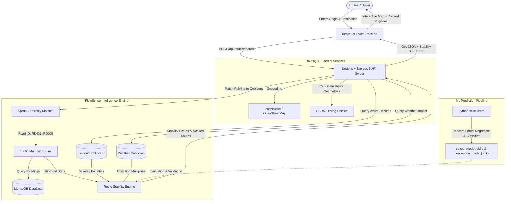

# 🚦 FlowSense — Predictive Traffic Flow & Adaptive Routing System

[](https://nodejs.org/)
[](https://expressjs.com/)
[](https://react.dev/)
[](https://vitejs.dev/)
[](https://www.mongodb.com/)
[](https://scikit-learn.org/)
[](https://opensource.org/licenses/MIT)

> **FlowSense** is an industry-grade, software-only intelligent navigation and traffic engineering platform. While conventional GPS systems route drivers based only on *current* instantaneous travel times, FlowSense predicts *future* congestion bottlenecks and scores candidate routes using a multi-factor **Predictive Route Stability Score**.

---

## 🌟 Core Value Proposition

Traditional routing applications suffer from the **"recency trap"**: a highway that is fast *now* may suffer a catastrophic rush-hour gridlock 15 minutes after you join it. FlowSense solves this with:

1. **🧠 Traffic Memory Engine:** Stores, indexes, and aggregates thousands of historical time-series traffic observations by road segment, day of week, and hour using MongoDB aggregation pipelines (`$match`, `$group`, `$avg`, `$cond`).
2. **🎯 Predictive Route Stability Score (0–100):** A transparent, explainable decision metric balancing expected future delays, historical speed variability, active road incidents, and adverse weather conditions.
3. **👥 Dedicated Multi-Role Architecture (RBAC):** Three tailored experiences with dedicated portals:
   - **Main System Admin:** Complete system oversight, database telemetry, corridor CRUD, user access control, and ML model audits.
   - **Traffic Authority & Police:** Operations room, emergency Green Corridor signal preemption dispatch, hazard resolution, and public advisory broadcasts.
   - **Public Commuter:** Predictive routing, stability score comparison, interactive GIS maps, weather forecasts, and hazard reporting.
4. **🚨 Active Hazard Dispatch & Green Corridor:** Real-time citizen/operator incident reporting + emergency vehicle prioritized corridors that clear traffic lights for a 45% travel-time reduction.
5. **🤖 Dual Prediction Architecture:**
   - **Baseline Weighted Model:** High-throughput rule engine with multi-tier temporal fallback (Exact Hour → Same Hour Any Day → Nearby Hours → Road Baseline).
   - **Machine Learning Model (scikit-learn):** Random Forest Regressor ($R^2 = 0.887$, $\text{MAE} = 2.94\text{ km/h}$) and Classifier ($78.9\%\text{ accuracy}$) trained on multi-variate road features.
6. **💡 Explainable Navigation:** Recommends routes with human-readable rationales (e.g., *"Route B is recommended because despite being 3 min longer currently, Route A has an 86% probability of high congestion spike at 18:00 with an active accident reported on RD001"*).
7. **✨ Ambient Cyber-Dark Visuals:** High-aesthetic UI with ambient neon glows (Royal Purple for Admin, Cyber Cyan for Police, Emerald Neon for Commuters) and glassmorphism.

---

## 👥 Three Tailored Roles & 1-Click Demo Accounts

FlowSense features dedicated portals with pre-seeded demo accounts for effortless 1-click evaluation:

| Role Persona | Target User | Portal URL | Ambient Theme | Pre-configured Demo Login | Key Capabilities |
|---|---|---|---|---|---|
| **👑 Main Administrator** | Platform & System Admin | `/admin` | Royal Purple (`#a855f7`) | `admin@flowsense.gov.in` / `admin` | Full CRUD, Database telemetry, User RBAC promote/demote, ML audits |
| **🚓 Traffic Authority** | Police Inspector / Govt Official | `/authority` | Cyber Cyan (`#06b6d4`) | `police@flowsense.gov.in` / `police` | Emergency Green Corridor dispatch, signal preemption, advisory broadcasts |
| **🚗 Public Commuter** | Drivers & Citizens | `/` | Neon Emerald (`#10b981`) | `citizen@flowsense.in` / `citizen` | Predictive route search, stability score breakdown, hazard reporting |

---

## 🏛️ System Architecture



---

## 🛠️ Technology Stack

| Layer | Technologies | Role & Purpose |
|---|---|---|
| **Frontend UI** | React 19, JavaScript (ES Modules), Vite 8 | Reactive, component-based user interface |
| **Routing & Navigation** | React Router DOM v7 | Single Page Application (SPA) client-side routing |
| **Interactive Maps** | Leaflet 1.9, React Leaflet 5, OpenStreetMap | Interactive GIS map, route geometry, custom markers |
| **Analytics & Charts** | Recharts 3.10 | Multi-axis composed trend charts (speed vs vehicle density) |
| **Styling** | Custom Modern CSS (Variables, Glassmorphism, Grid) | Polished, fully responsive mobile/tablet/desktop UI |
| **Backend API** | Node.js, Express 5.2 | RESTful API server, spatial matching, scoring logic |
| **Database** | MongoDB (v8 / Atlas / Local) + Mongoose 9.10 | Time-series traffic memory, geospatial segments, incidents |
| **Security** | Helmet.js, express-rate-limit, CORS | HTTP security headers, IP request rate limiting, CORS |
| **Routing Engine** | OSRM (Open Source Routing Machine) | Turn-by-turn driving routing, distances, travel times |
| **Geocoding** | Nominatim (OpenStreetMap) | Forward geocoding of place names to coordinates |
| **Machine Learning** | Python 3, scikit-learn, pandas, numpy, joblib | Random Forest speed regression and congestion classification |

---

## 📂 Project Directory Structure

```
FlowSense/
├── backend/                         # Express REST API & Database
│   ├── config/
│   │   └── db.js                    # Resilient MongoDB connector (Atlas + local fallback)
│   ├── middleware/
│   │   └── errorHandler.js          # Centralized error handling middleware
│   ├── models/
│   │   ├── RoadSegment.js           # Road metadata & coordinate waypoints
│   │   ├── TrafficRecord.js         # Historical time-series traffic observations
│   │   ├── Incident.js              # Active road hazards & accidents
│   │   └── Weather.js               # Meteorological observations & forecasts
│   ├── routes/
│   │   └── routeRoutes.js           # REST endpoints (search, analytics, incidents, weather)
│   ├── utils/
│   │   ├── geocode.js               # Nominatim geocoding client
│   │   ├── route.js                 # OSRM routing client
│   │   ├── matchRoadSegments.js     # Spatial proximity route-to-corridor matcher
│   │   ├── predictTraffic.js        # Traffic Memory aggregation engine
│   │   └── calculateStabilityScore.js # Predictive Route Stability algorithm
│   ├── .env                         # Environment variables (PORT, MONGO_URI)
│   ├── .env.example                 # Example environment template
│   ├── seedData.js                  # Comprehensive database seeder (3,080+ records)
│   ├── server.js                    # Express application entry point
│   └── package.json                 # Backend dependencies (Express 5, Mongoose 9, Helmet)
│
├── prediction/                      # Machine Learning Subsystem
│   ├── dataset/
│   │   ├── generate_dataset.py      # Multi-variate traffic simulation generator
│   │   └── traffic_dataset.csv      # 6,000-row tabular traffic dataset
│   ├── models/
│   │   ├── speed_model.joblib       # Trained Random Forest Regressor
│   │   └── congestion_model.joblib  # Trained Random Forest Classifier
│   ├── train.py                     # scikit-learn training & evaluation script
│   └── predict.py                   # CLI & programmatic inference interface
│
├── public/                          # Static assets and favicons
├── src/                             # React 19 Frontend
│   ├── assets/                      # Logos and images
│   ├── components/
│   │   ├── Navbar.jsx               # Header with active route links & backend health monitor
│   │   ├── SearchBox.jsx            # Location inputs, demo presets, swap button
│   │   ├── MapView.jsx              # Leaflet map with color-coded candidate polylines
│   │   ├── RouteCard.jsx            # Route comparison card with stability score & breakdown
│   │   ├── RouteList.jsx            # Ranked list of candidate routes
│   │   ├── TrafficAnalytics.jsx     # Traffic Memory filters, table, and data controls
│   │   ├── TrafficChart.jsx         # Dual-axis Recharts visualization (speed & volume)
│   │   ├── TrafficHeatmap.jsx       # 24-hour x 7-day congestion percentage heatmap
│   │   ├── WeatherWidget.jsx        # Live weather status pill
│   │   └── LoadingSpinner.jsx       # Animated loading indicator
│   ├── pages/
│   │   ├── Home.jsx                 # Route search, interactive map, results
│   │   ├── Dashboard.jsx            # Live telemetry, active incidents dispatch, memory analytics
│   │   └── IncidentReport.jsx       # Citizen/operator road hazard reporting form
│   ├── api.js                       # Centralized API service layer
│   ├── App.jsx                      # SPA Router layout
│   ├── App.css                      # Modern responsive design system
│   └── main.jsx                     # Vite React entry point
│
├── index.html                       # HTML5 template with typography and SEO metadata
├── vite.config.js                   # Vite config with proxy & optimized code-splitting chunks
└── README.md                        # Complete project documentation
```

---

## 🧮 Mathematical Formulation

### Predictive Route Stability Score ($S$)

The stability score compares how reliable a route is expected to remain over the journey horizon, penalizing delay risk, volatility, hazards, and adverse weather:

$$S = 100 - \left( 0.30 \cdot P_{\text{delay}} + 0.30 \cdot P_{\text{congestion}} + 0.15 \cdot P_{\text{variability}} + 0.15 \cdot P_{\text{incident}} + 0.10 \cdot P_{\text{weather}} \right)$$

Where:
1. **Delay Penalty ($P_{\text{delay}}$):** Additional travel time predicted versus current instantaneous time:
   $$P_{\text{delay}} = \min\left(100, \max\left(0, \frac{T_{\text{predicted}} - T_{\text{current}}}{T_{\text{current}}} \times 100\right)\right)$$
2. **Congestion Penalty ($P_{\text{congestion}}$):** Historical proportion of high-congestion observations for this road at the current day and hour ($0 \le P_{\text{congestion}} \le 100$).
3. **Speed Variability Penalty ($P_{\text{variability}}$):** Historical coefficient of variation in speed:
   $$P_{\text{variability}} = \min\left(100, 2 \times \frac{\sigma_{\text{speed}}}{\mu_{\text{speed}}} \times 100\right)$$
4. **Incident Penalty ($P_{\text{incident}}$):** Penalty points assigned based on active incident severity on that segment:
   $$P_{\text{incident}} = \min\left(100, \sum \text{SeverityWeight}\right) \quad (\text{HIGH}=30\text{ pts}, \text{MEDIUM}=15\text{ pts}, \text{LOW}=5\text{ pts})$$
5. **Weather Penalty ($P_{\text{weather}}$):** Environmental friction factor based on rainfall, fog, or storm conditions ($0\text{ to }25\text{ pts}$).

---

## 📊 Machine Learning Model Benchmarks

FlowSense includes a scikit-learn pipeline evaluated on a 6,000-sample dataset:

| Model Task | Algorithm | Metric | Test Set Result |
|---|---|---|---|
| **Speed Regressor** | Random Forest (100 estimators, depth 12) | **$R^2$ Score** | **0.887** |
| | | **Mean Absolute Error (MAE)** | **2.94 km/h** |
| | | **Root Mean Squared Error (RMSE)** | **3.83 km/h** |
| **Congestion Classifier** | Random Forest Classifier | **Overall Accuracy** | **78.92%** |
| | | **Precision (High Congestion)** | **0.74** |
| | | **Recall (High Congestion)** | **0.87** |
| | | **F1-Score (High Congestion)** | **0.80** |

---

## 🚀 Quick Start Guide

### Prerequisites
- [Node.js](https://nodejs.org/) (v18.0 or newer)
- [MongoDB](https://www.mongodb.com/try/download/community) running locally on `localhost:27017` (or MongoDB Atlas connection string)
- [Python 3.10+](https://www.python.org/) with `pip` (for running the ML module)

### 1. Installation

```bash
# Clone the repository
git clone https://github.com/your-username/FlowSense.git
cd FlowSense

# Install Frontend Dependencies
npm install

# Install Backend Dependencies
cd backend
npm install
cd ..
```

### 2. Configure Environment

The backend includes a pre-configured `.env`:
```env
PORT=5000
MONGO_URI=mongodb://127.0.0.1:27017/flowsense
```
*(If using MongoDB Atlas, simply update `MONGO_URI` with your connection string. The server automatically falls back to local MongoDB if Atlas connection times out.)*

### 3. Seed Database with Realistic Corridors

Run the automated seeder to initialize road segments, 3,080+ historical traffic readings, active hazards, and weather records:

```bash
node backend/seedData.js
```

### 4. Launch Application

**Terminal 1 — Backend:**
```bash
cd backend
npm run dev
# Server starts at http://localhost:5000
```

**Terminal 2 — Frontend:**
```bash
npm run dev
# Vite dev server starts at http://localhost:5173
```

Open **`http://localhost:5173`** in your browser.

### 5. Run the Python ML Subsystem (Optional)

```bash
# Train models and evaluate metrics
python prediction/train.py

# Test inference CLI for any scenario
python prediction/predict.py --road RD001 --day Friday --hour 18 --weather Rain --incidents 1
```

---

## 🔌 API Endpoints Reference

### Route Search & Stability
- `POST /api/routes/search`: Calculate candidate routes, match road segments, query Traffic Memory, and compute Predictive Route Stability Scores.
  - **Body:** `{"from": "Lovely Professional University", "to": "Jalandhar Cantt Railway Station"}`

### Traffic Memory & Analytics
- `GET /api/routes/analytics/:roadId`: Retrieve aggregated historical observations by hour and day of week.
- `GET /api/routes/traffic/history/:roadId`: 24-hour speed and vehicle volume trend data.
- `GET /api/routes/traffic`: Fetch raw historical readings.
- `POST /api/routes/traffic`: Ingest a new traffic reading.

### Incidents & Hazards
- `GET /api/routes/incidents`: Fetch all active road incidents.
- `POST /api/routes/incidents`: Submit a new road incident report.
- `PATCH /api/routes/incidents/:id/resolve`: Resolve/clear an active incident.

### Weather & Health
- `GET /api/routes/weather/:city`: Latest meteorological observations for a city.
- `GET /api/routes/segments`: Retrieve registered road segments and coordinates.
- `GET /api/health`: Health check endpoint.

---

## 🎓 Viva & Technical Interview Defense Guide

### Q1: What makes FlowSense different from Google Maps?
> **Answer:** Standard commercial routing algorithms primarily rely on current probe vehicle speeds to compute the shortest instantaneous path. However, instantaneous time does not account for impending congestion that forms while the user is en route. FlowSense incorporates a **Traffic Memory Engine** (analyzing temporal patterns across days and hours) and computes a **Predictive Route Stability Score**. If Route A is 2 minutes faster right now but has an 85% probability of severe congestion spike within 15 minutes, FlowSense alerts the driver and recommends the more stable Route B.

### Q2: How does FlowSense match an OSRM route to a MongoDB road segment?
> **Answer:** We implemented a geospatial proximity matcher (`matchRoadSegments.js`) using the Haversine formula. When OSRM returns coordinates for a candidate polyline, our algorithm tests waypoint proximity against registered road segment coordinates within a tolerance radius (50m). When the match threshold exceeds 80%, the route segment is linked to historical memory records for prediction.

### Q3: How is MongoDB aggregation utilized?
> **Answer:** FlowSense leverages multi-stage aggregation pipelines:
> - `$match` filters records by `roadId`, `dayOfWeek`, and `hour`.
> - `$group` calculates `$avg` vehicle counts, `$avg` speeds, total readings count, and high-congestion frequency using conditional `$cond` expressions.
> - `$project` shapes rounded percentages and metrics.
> - `$sort` organizes time-series outputs chronologically for chart visualization.

### Q4: How is the Machine Learning model validated against the baseline?
> **Answer:** FlowSense provides a transparent two-tier system: a deterministic weighted baseline algorithm for fast, explainable scoring, alongside a trained scikit-learn Random Forest model ($R^2 = 0.887$) that validates non-linear interactions between weather precipitation, incident counts, and speed degradation.

---

## 📄 License

This project is licensed under the **MIT License** — feel free to use, modify, and extend for educational, academic, and research purposes.
